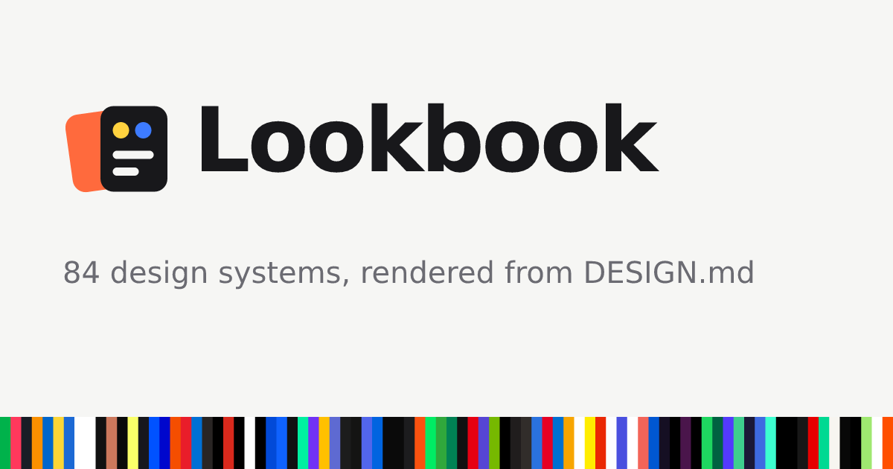

# Lookbook · 设计系统图鉴

[](https://liamamilin.github.io/Lookbook/)

**Lookbook 把 83 套知名产品的设计系统渲染成可以直接看、直接比、直接拿走的页面。**

每套设计系统都写在一份 `DESIGN.md` 里，包括颜色、字体、圆角、间距和组件。Lookbook 用这些设计令牌渲染出同一个示例页面，所以不用读文档，就能看出 Stripe、Linear、Notion、Vercel 这些设计系统用起来是什么样子。

👉 **在线访问：https://liamamilin.github.io/Lookbook/**

## 能做什么

- **浏览**：83 套设计系统分成 10 个类别，每张卡片都有缩略图。可以用中文或英文搜索，也可以按深色或浅色筛选。
- **预览**：每个模板都会渲染成一个完整的示例落地页，包括导航、首屏、按钮、卡片和页脚。
- **拆解**：
  - 色板（点击即可复制色值）
  - 字号层级
  - 圆角和间距
  - `components:` 里定义的每一个组件
- **对比**：把两套设计系统放到同一个页面上并排比较，可以互换左右，也可以随机抽两套。
- **导出**：点「一键导出」把下面所有格式打包成一个 .zip 下载，也可以单独复制或下载某一种：
  - **AI 提示词**：交给 Claude、Cursor、v0 等 AI 工具，让它们按这套风格写界面。可以附带完整的 DESIGN.md。
  - **CSS 变量**
  - **Tailwind v4** `@theme` 和 **Tailwind v3** 配置
  - **W3C Design Tokens JSON**：可以导入 Figma 的 Tokens Studio。
- **原始文档**：查看渲染后的 DESIGN.md 全文，也可以一键复制。
- **中文 / English**：界面可以切换语言，每个模板的简介都有中文译文。

## 怎么用

1. 在[模板库](https://liamamilin.github.io/Lookbook/)里找到喜欢的风格，或者在[风格对比](https://liamamilin.github.io/Lookbook/compare/)里挑一套。
2. 打开模板，点「一键导出」下载 .zip，解压到项目里；或者切到「导出」标签页，只拿需要的格式。
3. 用以下任一方式把这套风格带进你的项目：
   - 复制 AI 提示词，交给你常用的编码助手。
   - 把 CSS 变量或 Tailwind 配置放进项目。
   - 把 `DESIGN.md` 放到项目根目录，让 AI 编码助手随时参考。

## 本地开发

```bash
cd web
npm install
npm run dev      # http://127.0.0.1:5178/Lookbook/
npm test         # 数据解析、全部页面渲染、导出格式、文字对比度
npm run build    # 静态站点输出到 web/dist/
```

推送到 `main` 后，GitHub Actions 会自动测试、构建，并发布到 GitHub Pages。

## 目录结构

| 路径 | 内容 |
|---|---|
| [`design-md/`](design-md) | 83 份 `DESIGN.md`，每个目录一套设计系统 |
| [`CATALOG.md`](CATALOG.md) | 模板的分类和一句话简介，模板库的卡片和筛选都从这里读取 |
| [`web/`](web) | Lookbook 前端（Vite，原生 JS），详见 [`web/README.md`](web/README.md) |
| [`.github/workflows/lookbook.yml`](.github/workflows/lookbook.yml) | CI：测试、构建、部署到 GitHub Pages |

### 添加一套设计系统

1. 新建 `design-md/<slug>/DESIGN.md`。建议使用 YAML 前置数据（`colors`、`typography`、`rounded`、`spacing`、`components`），也兼容只有 Markdown 的旧格式。
2. 在 [`CATALOG.md`](CATALOG.md) 对应的分类下加一行：

   ```
   - [**Name**](https://getdesign.md/<slug>/design-md) - tagline
   ```

3. （可选）在 [`web/src/zh-descriptions.js`](web/src/zh-descriptions.js) 里补上中文简介。
4. 运行 `npm test`。测试会检查新模板能否解析、能否渲染，以及文字对比度是否达标。

## 致谢

`design-md/` 里的 DESIGN.md 模板和 `CATALOG.md` 的分类，来自 [VoltAgent/awesome-design-md](https://github.com/VoltAgent/awesome-design-md)（MIT 许可，见 [LICENSE](LICENSE)）。各品牌名称和视觉风格归其各自所有者。

Lookbook 的前端代码同样以 MIT 许可发布。
